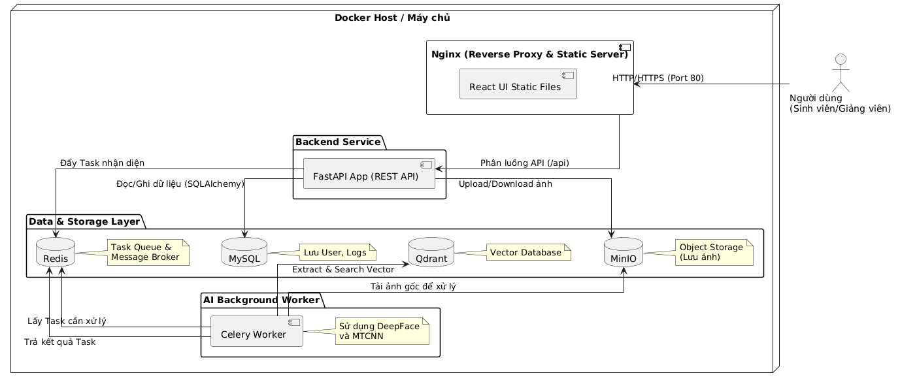

# Bài tập lớn Thực hành phát triển hệ thống Trí Tuệ Nhân Tạo

## Sơ đồ thiết kế hệ thống (UML)

Các sơ đồ thiết kế chi tiết luồng dữ liệu và logic của hệ thống:

* **Sơ đồ Use Case:** 
* **Sơ đồ Sequence:** 
* **Sơ đồ Deployment:** 
* **Sơ đồ Activity (Điểm danh):** 

## Kiến trúc hệ thống

Hệ thống được xây dựng trên kiến trúc Microservices để tối ưu hóa việc xử lý AI và đảm bảo tính mở rộng.



## Pipeline AI

### 1) Luồng đăng ký (Registration)
1. Client gửi danh sách ảnh kèm MSSV lên Backend.
2. Backend gửi ảnh sang Worker.
3. Worker chạy YOLO để detect/crop khuôn mặt, trích xuất embedding cho từng ảnh.
4. Worker tính master embedding và trả về Backend.
5. Backend lưu thông tin sinh viên + master embedding vào MySQL.
6. Backend cache master embedding vào Redis và lưu ảnh gốc vào MinIO (audit).

### 2) Luồng điểm danh (Attendance)
1. Client gửi MSSV + frame ảnh hiện tại lên Backend.
2. Backend lấy master embedding từ Redis (cache miss thì query MySQL và nạp lại Redis).
3. Backend gửi frame ảnh sang Worker để detect/crop và trích xuất current embedding.
4. Backend tính cosine similarity giữa current embedding và master embedding.
5. Nếu vượt ngưỡng: ghi log thành công, trả kết quả điểm danh.
6. Nếu không vượt ngưỡng hoặc không phát hiện mặt: ghi log thất bại và trả lỗi.

## Cấu trúc thư mục
```
/
├── backend
│   ├── Dockerfile
│   ├── README.md
│   ├── requirements.txt
│   └── src
│       ├── api
│       │   ├── __init__.py
│       │   └── v1
│       │       ├── attendance.py
│       │       ├── auth.py
│       │       ├── dashboard.py
│       │       ├── __init__.py
│       │       └── members.py
│       ├── core
│       │   ├── celery_client.py
│       │   ├── config.py
│       │   ├── __init__.py
│       │   ├── qdrant_client.py
│       │   └── security.py
│       ├── database
│       │   ├── Base.py
│       │   └── __init__.py
│       ├── __init__.py
│       ├── main.py
│       ├── models
│       │   ├── attendance.py
│       │   ├── face_embedding.py
│       │   ├── __init__.py
│       │   └── user.py
│       ├── schemas
│       │   ├── attendance.py
│       │   ├── __init__.py
│       │   └── user.py
│       ├── services
│       │   ├── __init__.py
│       │   ├── member_service.py
│       │   ├── redis_query.py
│       │   └── storages.py
│       └── utils
│           ├── __init__.py
│           └── video_processor.py
├── docker-compose-network.yml
├── docker-compose.yml
├── document.md
├── frontend
│   ├── Dockerfile
│   ├── index.html
│   ├── package.json
│   ├── pnpm-lock.yaml
│   ├── public
│   │   ├── favicon.ico
│   │   └── manifest.json
│   ├── src
│   │   ├── admin
│   │   │   ├── AdminSidebar.vue
│   │   │   ├── Dashbroad.vue
│   │   │   ├── pages
│   │   │   │   ├── AttendanceLogs.vue
│   │   │   │   ├── Dashboard.vue
│   │   │   │   └── RegisterAttendance.vue
│   │   │   ├── RecentActivity.vue
│   │   │   ├── StatCard.vue
│   │   │   └── TopHeader.vue
│   │   ├── App.vue
│   │   ├── main.js
│   │   ├── router.js
│   │   ├── shared
│   │   │   ├── api.js
│   │   │   ├── dateUtils.js
│   │   │   └── styles.css
│   │   └── user
│   │       └── CheckIn.vue
│   └── vite.config.js
├── ke_hoach_trien_khai.md
├── nginx
│   ├── Dockerfile
│   └── nginx.conf
├── README.md
├── todo.txt
├── uml
│   ├── Activity_diem_danh.png
│   ├── activity_diem_danh.puml
│   ├── Component.png
│   ├── component.puml
│   ├── Deployment.png
│   ├── deployment.puml
│   ├── README.md
│   ├── requirements.md
│   ├── sequence.puml
│   ├── sequency.png
│   ├── usecase.png
│   └── usecase.puml
└── worker
    ├── Dockerfile
    ├── requirements.txt
    └── src
        ├── celery_app.py
        ├── face_engine.py
        ├── __init__.py
        └── tasks.py

22 directories, 79 files
```


## Thông tin nhóm

- 24022454 - Lê Việt Thành (Trưởng nhóm)
- 24022406 - Nguyễn Nhật Minh
- 24022364 - Tạ Duy Khánh
- 24022394 - Nguyễn Đức Mạnh

## Phân chia công việc

| STT | MSSV | Họ và tên | Vai trò chính | Công việc phụ trách |
| --- | --- | --- | --- | --- |
| 1 | 24022454 | Lê Việt Thành | Trưởng nhóm, DevOps | Thiết kế kiến trúc tổng thể; dựng docker-compose; cấu hình Nginx gateway; tổ chức nhánh Git, review và merge code; chuẩn hóa tài liệu README. |
| 2 | 24022406 | Nguyễn Nhật Minh | Backend Developer | Xây dựng FastAPI (routes, schemas, models); kết nối Postgres/Redis/MinIO/Qdrant; xử lý logic checkin/checkout và API cho frontend. |
| 3 | 24022364 | Tạ Duy Khánh | AI/Worker Developer | Xây dựng Celery worker; cài đặt pipeline xử lý ảnh khuôn mặt; triển khai task trích xuất vector bằng DeepFace; tối ưu thời gian xử lý nền. |
| 4 | 24022394 | Nguyễn Đức Mạnh | Frontend Developer, QA | Xây dựng giao diện người dùng và admin/dashbroad; tích hợp API từ backend; kiểm thử chức năng end-to-end; kiểm tra trải nghiệm người dùng. |

## Ghi chú phối hợp

- Mỗi thành viên chịu trách nhiệm chính phần việc được phân công và hỗ trợ chéo khi tích hợp hệ thống.

## Cách chạy trên máy

Sử dụng lệnh docker compose:
```
# Build từng images
docker compose build

# Chạy các images
docker compose up -d

#Xem logs
docker compose logs -f
```

Nếu máy bạn đã dùng cổng `3306`, hãy đổi `MYSQL_PORT` trong file `.env` sang một cổng khác, ví dụ `3307`, rồi chạy lại `docker compose up -d`.

## Hướng dẫn triển khai (Deployment)
Hệ thống đã được đóng gói dưới dạng Docker Images trên Docker Hub. Để chạy toàn bộ hệ thống mà không cần cài đặt môi trường code, thực hiện các bước sau:

1. Chuẩn bị
    - Tải file docker-compose.yml về máy.
    - Tạo file .env cùng cấp với các thông số mẫu từ .env.example.

2. Khởi chạy
    - Tại thư mục chứa docker-compose.yml, chạy:
```
docker compose up -d
```

Docker sẽ tự động kéo các image sau:
```
levietthanh1412/attendance-backend:v2
levietthanh1412/attendance-frontend:v2
levietthanh1412/attendance-worker:v2
levietthanh1412/attendance-nginx:v2
```

3. Địa chỉ truy cập
- Frontend: http://localhost:8080
- API Swagger: http://localhost:8000/docs
- MinIO Storage: http://localhost:9001
- Demo: attendance.thanhtech.cloud