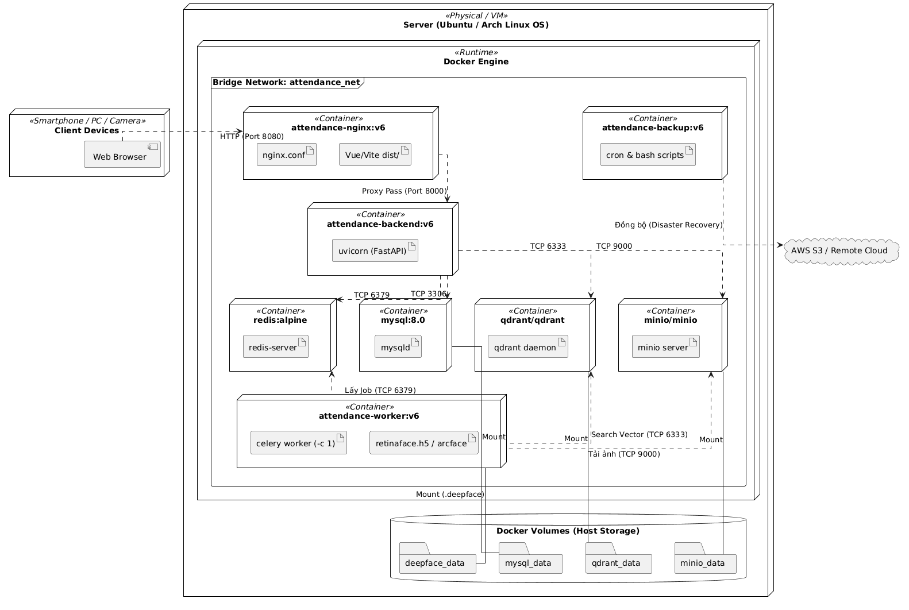
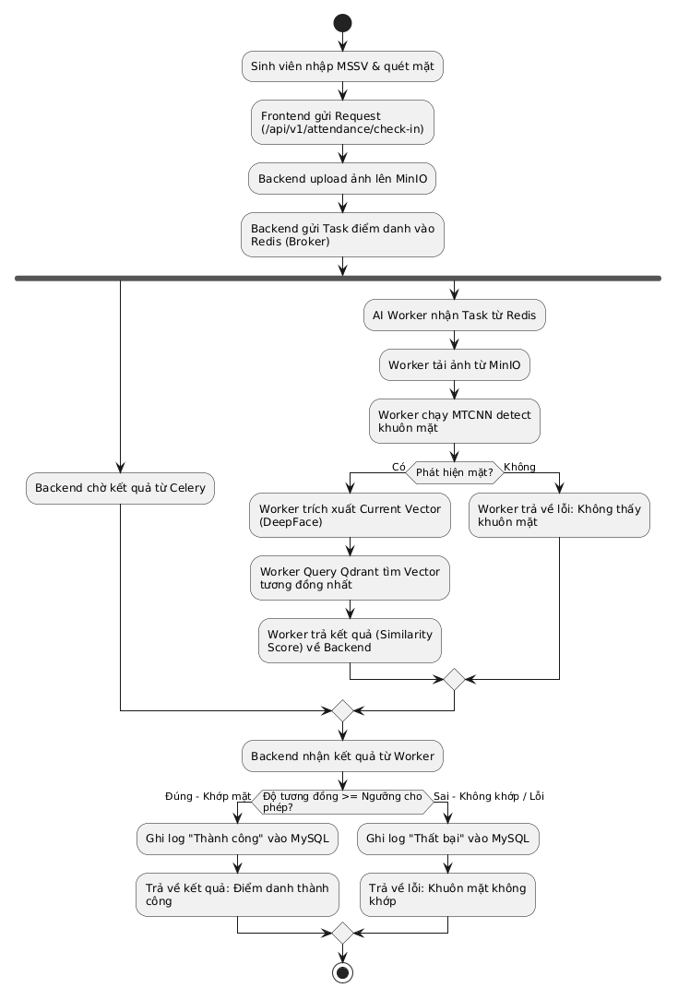
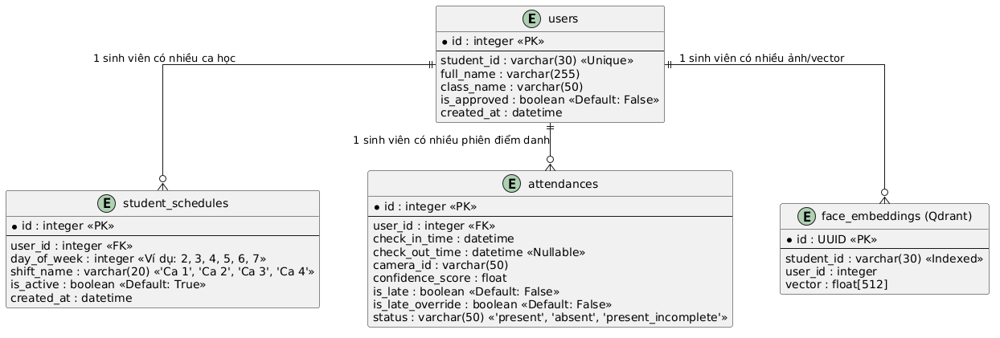
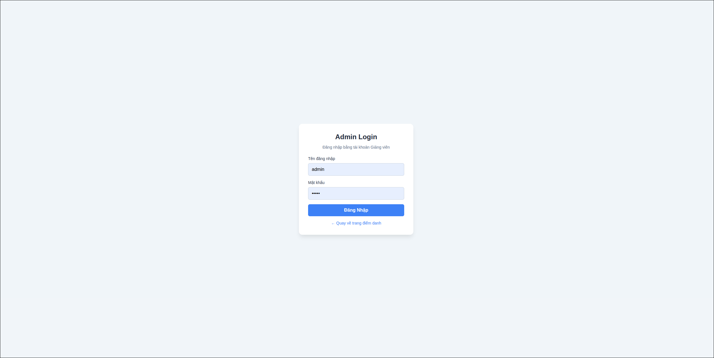
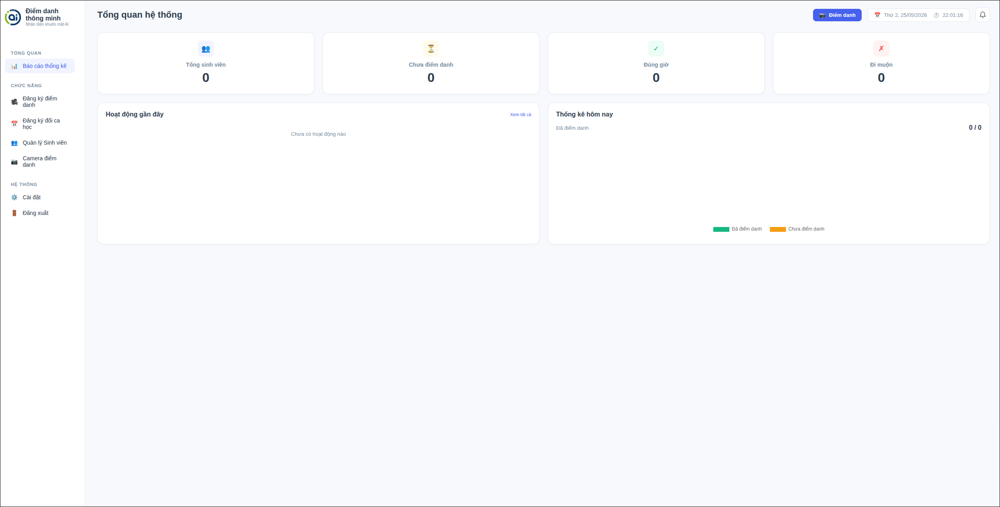
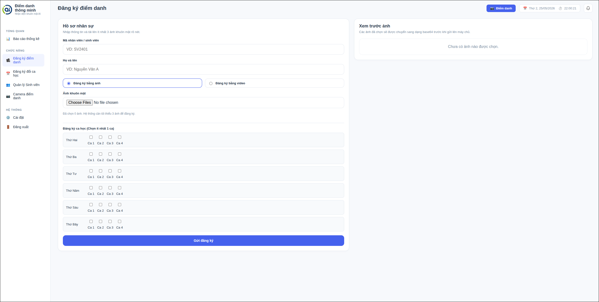

# Smart Attendance System (Hệ Thống Điểm Danh Thông Minh)

Hệ thống điểm danh tự động bằng nhận diện khuôn mặt, triển khai theo kiến trúc microservices. Dự án kết hợp DeepFace (ArcFace), Qdrant Vector DB và Celery/Redis để đảm bảo tốc độ xử lý nhanh, chính xác và dễ mở rộng.

## Mục tiêu

- Xác minh 1-1 theo mã sinh viên để hạn chế điểm danh hộ.
- Tối ưu thời gian điểm danh bằng xử lý bất đồng bộ.
- Cung cấp dashboard quản trị, log chi tiết và báo cáo CSV.

## Tính năng chính

- Đăng ký sinh viên bằng ảnh hoặc video, tự động trích xuất vector khuôn mặt.
- Điểm danh check-in/check-out theo ca học, hỗ trợ đa phiên trong ngày.
- Tự động phát hiện đi muộn theo ngưỡng thời gian.
- Duyệt sinh viên, duyệt lịch học và sửa trạng thái điểm danh.
- Dashboard thống kê, nhật ký phân trang, thông báo và xuất CSV.
- Lưu ảnh bằng MinIO, vector bằng Qdrant, dữ liệu nghiệp vụ bằng MySQL.
- Sao lưu định kỳ MySQL/Qdrant/MinIO vào thư mục local.

## Kiến trúc hệ thống

Hệ thống gồm 8 container độc lập:

1. Frontend (Vue 3 + Vite + Nginx)
2. Backend (FastAPI)
3. Worker (Celery + DeepFace)
4. Qdrant (Vector DB)
5. Redis (Message Broker/Cache)
6. MinIO (Object Storage)
7. MySQL 8.0 (RDBMS)
8. Backup service (Local backup)

Sơ đồ kiến trúc và UML nằm trong thư mục `uml/`:






## Cài đặt nhanh (Docker Compose)

### Bước 1: Chuẩn bị

- Docker Engine + Docker Compose
- RAM trống tối thiểu 4GB

### Bước 2: Khởi tạo cấu hình

```bash
cp .env.example .env
```

### Bước 3: Chạy hệ thống

```bash
docker compose up --build -d
```

Nếu muốn chạy bằng các image đã build sẵn:

```bash
docker compose -f docker-compose-network.yml up -d
```

Lưu ý: file `docker-compose-network.yml` map cổng Nginx ra `80`.

### Bước 4: Kiểm tra trạng thái

```bash
docker compose ps
```

## Truy cập hệ thống

- Frontend: http://localhost:8080
- API Docs (Swagger): http://localhost:8080/api/docs
- Health check: http://localhost:8080/api/health
- MinIO Console: http://localhost:9001
- Qdrant Dashboard: http://localhost:6333/dashboard

Tài khoản admin mặc định lấy từ `.env`:

```
ADMIN_USERNAME=admin
ADMIN_PASSWORD=admin
```

## Cấu hình môi trường quan trọng

| Biến | Mô tả |
| --- | --- |
| DATABASE_URL / MYSQL_* | Kết nối MySQL |
| QDRANT_URL / QDRANT_COLLECTION | Vector DB Qdrant |
| MINIO_ENDPOINT / MINIO_ACCESS_KEY / MINIO_SECRET_KEY | Object Storage |
| FACE_MATCH_THRESHOLD | Ngưỡng khớp khuôn mặt |
| DEEPFACE_MODEL_NAME | Mô hình trích xuất vector |
| FACE_DETECTOR_BACKEND | Bộ dò khuôn mặt (mtcnn, retinaface, ...) |
| TIME_LATE | Ngưỡng đi muộn (HH:MM) |
| ADMIN_USERNAME / ADMIN_PASSWORD / JWT_SECRET | Auth quản trị |

## Tổng quan API

Base URL: `/api/v1`

- Auth: `/auth/login`
- Members: `/members`, `/members/register`, `/members/register-video`, `/members/{student_id}/approve`, `/members/{student_id}` (DELETE)
- Schedule: `/schedule/{student_id}`, `/schedule/{student_id}/approve`, `/schedule/{student_id}/reject`, `/schedule/{student_id}/history`
- Attendance: `/attendance/check-in`, `/attendance/{attendance_id}/override`
- Dashboard: `/dashboard/statistics`, `/dashboard/recent-activities`, `/dashboard/attendance-logs`, `/dashboard/notifications`, `/dashboard/notifications/list`, `/dashboard/export-attendance`
- Health: `/health`

## Sao lưu dữ liệu

Container `backup` chạy định kỳ (mặc định 24 giờ) và lưu vào thư mục `local_backups/`:

- MySQL dump: `local_backups/mysql/`
- Qdrant snapshot: `local_backups/qdrant/`
- MinIO mirror: `local_backups/minio/`

Retention mặc định là 7 ngày.

## Cấu trúc thư mục

```
.
|-- backend/
|-- worker/
|-- frontend/
|-- nginx/
|-- backup/
|-- uml/
|-- report/
|-- docker-compose.yml
|-- docker-compose-network.yml
```

## Demo giao diện





## Troubleshooting

- Worker xử lý chậm ở lần chạy đầu do tải model DeepFace (ArcFace). Đây là hành vi bình thường.
- Nếu không truy cập được API, kiểm tra log: `docker compose logs -f backend`.
- Nếu nhận dạng thất bại liên tục, kiểm tra ngưỡng `FACE_MATCH_THRESHOLD` và chất lượng ảnh đầu vào.

## Thông tin nhóm

| STT | MSSV | Họ và tên | Vai trò chính |
| --- | --- | --- | --- |
| 1 | 24022454 | Lê Việt Thành | Trưởng nhóm, DevOps, Thiết kế hệ thống |
| 2 | 24022406 | Nguyễn Nhật Minh | Backend Developer |
| 3 | 24022364 | Tạ Duy Khánh | AI/Worker Developer |
| 4 | 24022394 | Nguyễn Đức Mạnh | Frontend Developer |