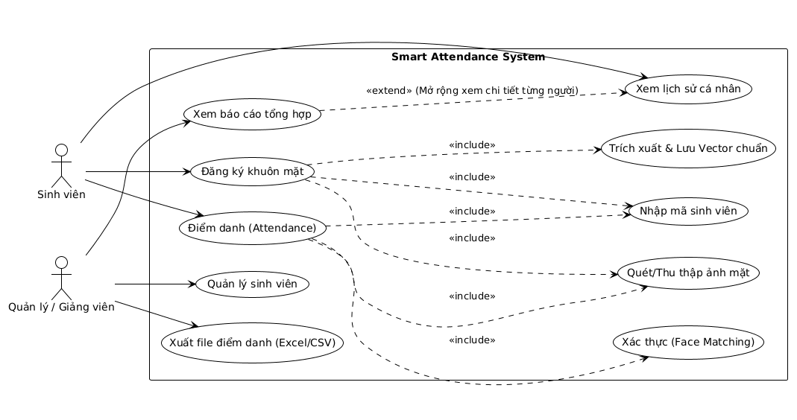
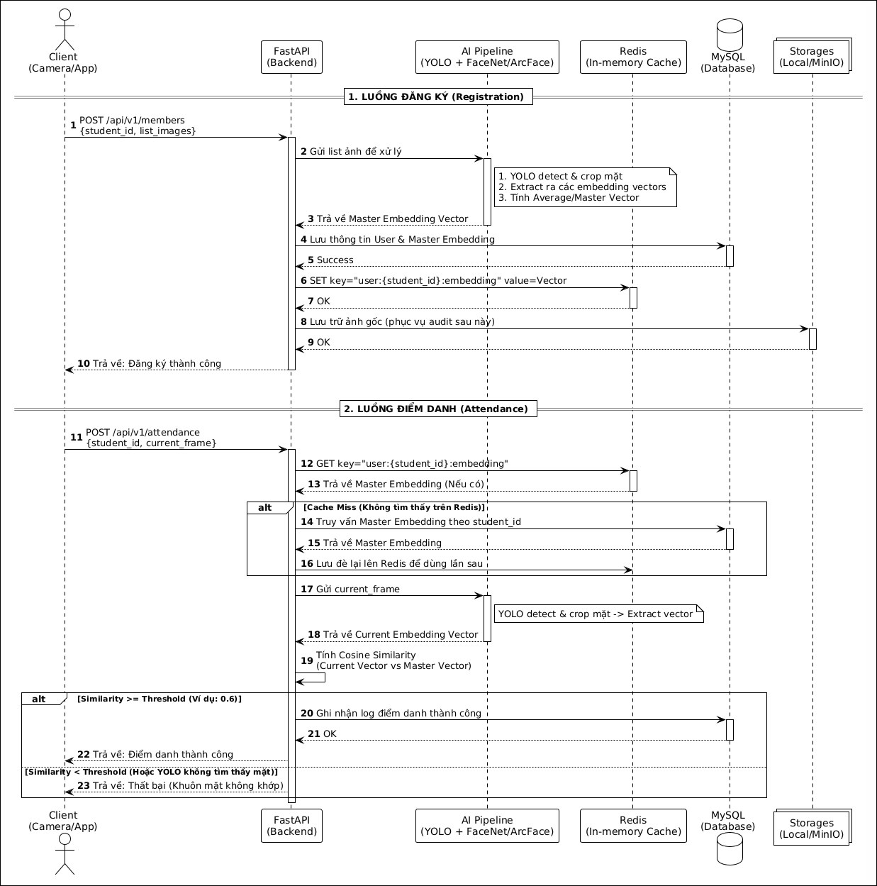
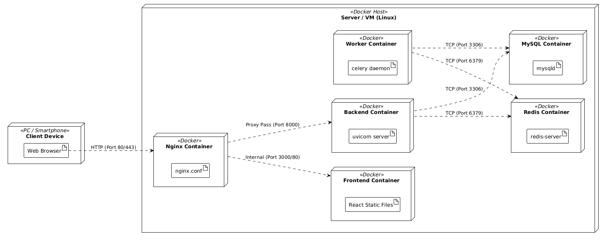
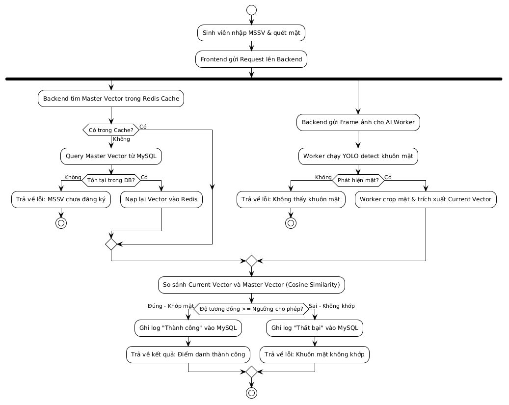
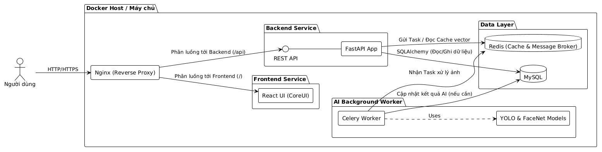

# Bài tập lớn Thực hành phát triển hệ thống Trí Tuệ Nhân Tạo

## Sơ đồ thiết kế hệ thống (UML)

Các sơ đồ thiết kế chi tiết luồng dữ liệu và logic của hệ thống:

* **Sơ đồ Use Case:** 
* **Sơ đồ Sequence:** 
* **Sơ đồ Deployment:** 
* **Sơ đồ Activity (Điểm danh):** 

## Kiến trúc hệ thống

Hệ thống được xây dựng trên kiến trúc Microservices để tối ưu hóa việc xử lý AI và đảm bảo tính mở rộng.



## Cấu trúc thư mục
```
/
├── backend
│   ├── Dockerfile
│   ├── README.md
│   ├── requirements.txt
│   └── src
│       ├── api
│       │   └── v1
│       │       ├── attendance.py
│       │       ├── auth.py
│       │       ├── dashboard.py
│       │       └── members.py
│       ├── core
│       │   ├── celery_client.py
│       │   ├── config.py
│       │   ├── qdrant_client.py
│       │   └── security.py
│       ├── database
│       │   └── Base.py
│       ├── main.py
│       ├── models
│       │   ├── attendance.py
│       │   ├── face_embedding.py
│       │   └── user.py
│       ├── schemas
│       │   ├── attendance.py
│       │   └── user.py
│       ├── services
│       │   ├── member_service.py
│       │   ├── redis_query.py
│       │   └── storages.py
│       └── utils
│           └── video_processor.py
├── frontend
│   ├── Dockerfile
│   ├── index.html
│   ├── package.json
│   ├── src
│   │   ├── admin/
│   │   ├── user/
│   │   ├── shared/
│   │   ├── App.vue
│   │   └── main.js
│   └── vite.config.js
├── nginx
│   ├── Dockerfile
│   └── nginx.conf
├── worker
│   ├── Dockerfile
│   ├── requirements.txt
│   └── src
│       ├── celery_app.py
│       ├── face_engine.py
│       └── tasks.py
├── docker-compose.yml
└── README.md
```


## Thông tin nhóm

- 24022454 - Lê Việt Thành (Trưởng nhóm)
- 24022406 - Nguyễn Nhật Minh
- 24022364 - Tạ Duy Khánh
- 24022394 - Nguyễn Đức Mạnh

## Phân chia công việc

| STT | MSSV | Họ và tên | Vai trò chính | Công việc phụ trách |
| --- | --- | --- | --- | --- |
| 1 | 24022454 | Lê Việt Thành | Trưởng nhóm, DevOps | Thiết kế kiến trúc tổng thể; dựng docker-compose; cấu hình Nginx gateway; tổ chức nhánh Git, review và merge code; chuẩn hóa tài liệu README. |
| 2 | 24022406 | Nguyễn Nhật Minh | Backend Developer | Xây dựng FastAPI (routes, schemas, models); kết nối Postgres/Redis/MinIO/Qdrant; xử lý logic checkin/checkout và API cho frontend. |
| 3 | 24022364 | Tạ Duy Khánh | AI/Worker Developer | Xây dựng Celery worker; cài đặt pipeline xử lý ảnh khuôn mặt; triển khai task trích xuất vector bằng DeepFace; tối ưu thời gian xử lý nền. |
| 4 | 24022394 | Nguyễn Đức Mạnh | Frontend Developer, QA | Xây dựng giao diện người dùng và admin/dashbroad; tích hợp API từ backend; kiểm thử chức năng end-to-end; kiểm tra trải nghiệm người dùng. |

## Ghi chú phối hợp

- Mỗi thành viên chịu trách nhiệm chính phần việc được phân công và hỗ trợ chéo khi tích hợp hệ thống.

## Cách chạy trên máy

Sử dụng lệnh docker build
```
#Build từng images
docker compose build

# Chạy các images
docker compose up -d

#Xem logs
docker compose logs -f
```

## Hướng dẫn triển khai (Deployment)
Hệ thống đã được đóng gói dưới dạng Docker Images trên Docker Hub. Để chạy toàn bộ hệ thống mà không cần cài đặt môi trường code, chỉ cần thực hiện các bước sau:

## Docker sẽ tự động kéo các Image từ Docker Hub:
* `levietthanh1412/attendance-backend:v1`
* `levietthanh1412/attendance-frontend:v1`
* `levietthanh1412/attendance-worker:v1`
* `levietthanh1412/attendance-nginx:v1`

1. Chuẩn bị
Tải file docker-compose.yml về máy và tạo file .env cùng cấp với các thông số mẫu từ .env.example.

2. Khởi chạy
Tại thư mục chứa file docker-compose.yml, chạy lệnh:

```
docker compose up -d
```

Docker sẽ tự động kéo các Image từ Docker Hub:
```
levietthanh1412/attendance-backend:v1

levietthanh1412/attendance-frontend:v1

levietthanh1412/attendance-worker:v1

levietthanh1412/attendance-nginx:v1
```

3. Địa chỉ truy cập

Frontend: http://localhost:8080

API Swagger: http://localhost:8000/docs

MinIO Storage: http://localhost:9001
